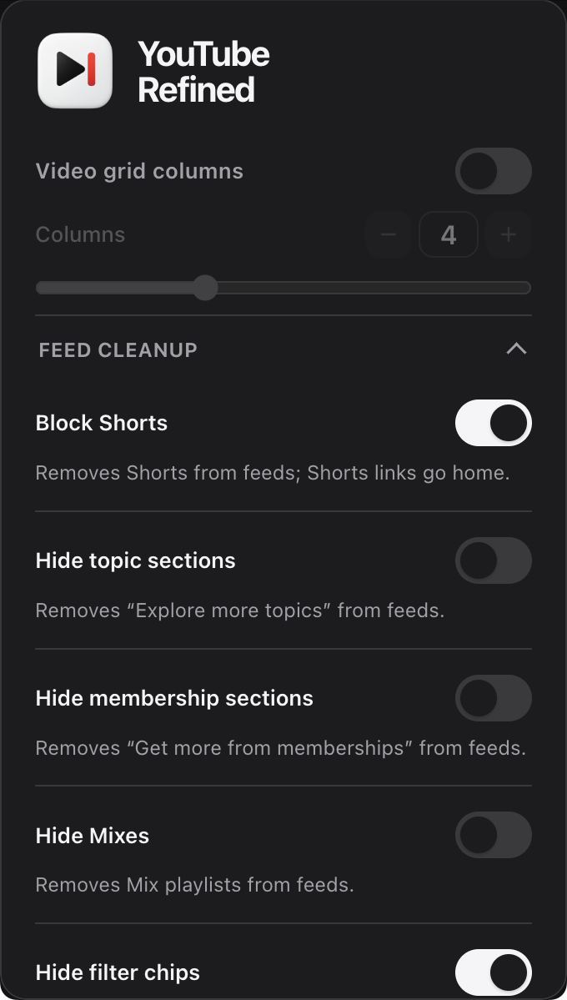

# YouTube Refined

A lightweight, distraction-free browser extension to declutter YouTube. Customize your video grid layout, block Shorts, clean up the navigation bar, and hide unwanted feed shelves — with zero tab reloads and no tracking.

---

## Preview

  

---

## Features

- **Custom Video Grid:** Set 1 to 10 video columns per row with a slider. Automatically adapts to fit smaller windows.
- **Navbar Controls:** Hide the Create button, Voice Search, Notification bell, or Country Code badge. Adds an optional one-click Settings shortcut next to your profile.
- **Mini-Sidebar Toggle:** Hides the collapsed left navigation strip for edge-to-edge feeds while keeping the hamburger menu functional.
- **Block Shorts:** Removes Shorts shelves, chips, and grid cards. Automatically redirects Shorts URLs to the home feed.
- **Feed Cleanup:** Hide "Explore more topics", channel membership promos, auto-generated Mixes, and top filter chips.
- **Feed Filters:** Filter out live streams, playlists, or already-watched videos.
- **Watch Page:** Hide comments, the recommendation sidebar, or end-screen cards for distraction-free viewing.

---

## Key Details

- **Instant Updates:** Settings apply immediately to all open tabs via extension storage change events. No page reload required.
- **Flicker-Free:** Core styles inject at `document_start` to prevent layout flashes.
- **Private & Lightweight:** Vanilla JavaScript with zero external dependencies, trackers, or telemetry.

---

## Installation

### Chrome

1. Open `chrome://extensions`.
2. Enable **Developer mode**.
3. Choose **Load unpacked** and select the provided Chrome extension folder.
4. Pin **YouTube Refined** from the extensions toolbar.

### Firefox

**Signed release:** Open `about:addons` → gear menu → **Install Add-on From File**, then select the signed Firefox `.xpi`.

**Local development:** Open `about:debugging` → **This Firefox** → **Load Temporary Add-on**, then select `manifest.json` in the provided Firefox folder. The temporary add-on is removed when Firefox closes.

---

## Privacy & License

- **100% Local:** No analytics, tracking, or network calls. Preferences stay in your browser.
- Licensed under the [MIT License](LICENSE).
