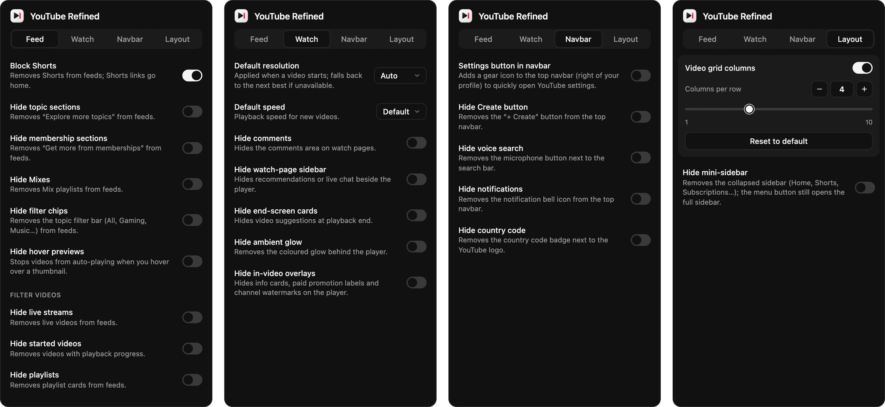
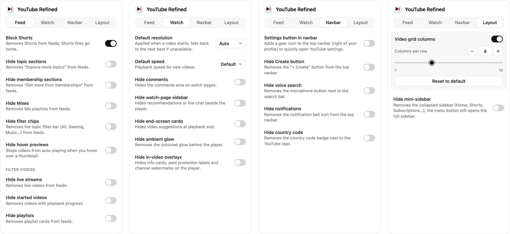

# YouTube Refined

YouTube Refined is a Chrome extension that lets you choose what you see on YouTube. If you like reading the comments on a video but rarely watch Shorts, you can keep the comments and hide Shorts. You can also change how many thumbnails fit in a row and pick the speed and quality you prefer for playback.

## Getting started

You'll need Chrome 111 or newer.

1. Download the extension ZIP from the [Releases page](../../releases) and unzip it into a folder you plan to keep.
2. Open `chrome://extensions` in Chrome and turn on **Developer mode** in the top right.
3. Click **Load unpacked** and select the folder that contains `manifest.json`. If you downloaded or cloned the source code, select the `ext` folder.
4. Click the puzzle-piece icon in Chrome's toolbar and pin **YouTube Refined** so it's easy to reach while you're watching.

Open YouTube and click the YouTube Refined icon in your toolbar. The popup has four tabs. Try opening **Layout** and moving the column slider while your home feed is visible. Changes apply across your open YouTube tabs without a refresh. Chrome saves your choices for the next time you visit.

## What you can change

### Feed

Shorts are blocked by default. This removes Shorts from your feed and takes you to the home page if you open a Shorts link. Turn off **Block Shorts** to bring them back. You can also hide Mixes, membership offers, topic suggestions, or the row of filter buttons above the feed. To skip videos you've already started, hide videos with playback progress. Live streams and playlists have separate switches. If moving the pointer over a thumbnail starts a preview, you can switch those previews off here.

### Watch

Choose a playback speed from 0.75× to 2× and a preferred video quality. Leave quality on **Auto** to let YouTube decide, or choose **Highest** for the best quality available on each video. You can hide comments, suggested videos beside the player, or cards that appear at the end. There are also switches for the glow behind the player and overlays such as info cards and channel watermarks.

### Navbar

Hide buttons you seldom use, such as Create, voice search, or the notification bell. If you often open YouTube's settings, add a gear button beside your profile picture.

### Layout

The home feed starts at four columns. Choose from one to ten, depending on your screen width. Fewer columns give each thumbnail more room. You can also hide the narrow sidebar and still open the full menu when you need it.

YouTube Refined doesn't track what you watch or collect personal data. It's released under the [MIT License](LICENSE).
